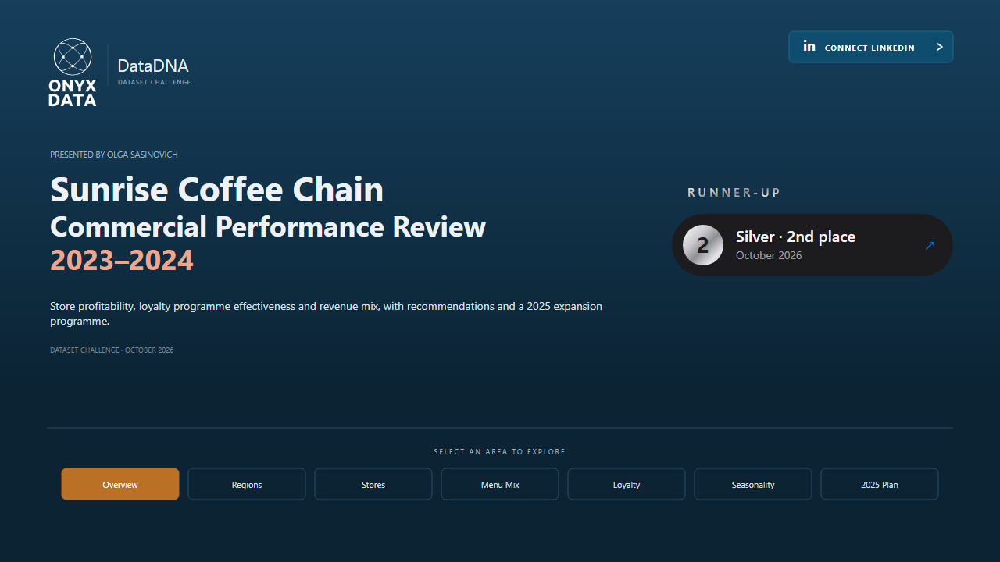

# 📊 Power BI Analytics Portfolio

Welcome to my interactive data visualization and business intelligence portfolio. Here, I transform raw data into actionable insights that drive strategic decisions.

---

## 🚀 Projects

### 1. 📱 CEO Daily Overview: Mobile Power BI Report

* **Objective:** Give a CEO who is always on the move a one-minute morning briefing on his phone: day, week, month and year against last year, with a monthly forecast and a department view.
* **Tech Stack:** Power BI (PBIP), DAX, Deneb (Vega-Lite), Mobile Layout, HTML Prototype.
* **Key Visuals:** [▶ Interactive Report](https://olga-bi-ba.github.io/Power-BI-portfolio/projects/ceo-daily-overview-mobile/) | [Cover Preview](projects/ceo-daily-overview-mobile/cover.png) | [Project Details](projects/ceo-daily-overview-mobile/README.md)

 

### 2. 🛍️ Contoso Sales Performance Analysis
* **Objective:** Identify revenue leakages and optimize product mix across retail channels.
* **Tech Stack:** Power BI, DAX, Power Query, Star Schema.
* **Key Visuals:** [Overview Preview](assets/previews/contoso-overview.png) | [Deep Dive Walkthrough](projects/contoso-sales/README.md)

### 3. 📦 Workforce Analytics (HR)
* **Objective:** Analyze employee turnover, recruitment metrics, and team performance.
* **Tech Stack:** Power BI, Advanced DAX.
* **Key Visuals:** [Project Folder](projects/workforce-analytics/)

### 4. ☕ Sunrise Coffee Commercial Performance Review (2023–2024)

* **Objective:** Find where store profit leaks across a 60-store chain and build a costed 2025 plan. Result: a plan worth about £1.76M a year, lifting net margin from 18.8% to 22.7%.
* **Tech Stack:** Power BI (PBIP), DAX, Star Schema, Field Parameters, Drill-through.
* **Key Visuals:** [Cover Preview](projects/sunrise-coffee-performance/screenshots/00-sunrise-coffee-cover.png) | [All Screenshots](projects/sunrise-coffee-performance/screenshots/) | [Project Details](projects/sunrise-coffee-performance/README.md)

 

### 5. 🏨 Maison d'Or Hotel Investment Plan

* **Objective:** Find why the most profitable brand of a luxury hotel group (30 hotels, 36% of profit) saw profit fall, and build a costed investment plan for the CEO, CFO and board. Result: a $155.6M plan in six projects that adds $28M profit a year and pays back in 2035.
* **Tech Stack:** Power BI (PBIP), DAX, Galaxy Schema, Deneb (Vega-Lite), Scenario Analysis.
* **Key Visuals:** [▶ Interactive Report](https://olga-bi-ba.github.io/Power-BI-portfolio/projects/maison-dor-investment-plan/) | [Cover Preview](projects/maison-dor-investment-plan/cover.png) | [Project Details](projects/maison-dor-investment-plan/README.md)

 

---

## 🛠️ Core Competencies & Tech Stack
* **Data Modeling:** Star Schemas, Snowflake Schemas Galaxy, Fact/Dimension relationships.
* **DAX & Power Query:** Complex Measures, Time Intelligence.
* **UX/UI for BI:** Designing clean, user-friendly layouts based on visual hierarchy.

---

## 📬 Contact & Connect
* **LinkedIn:** [Olga Sasinovich]([https://linkedin.com](https://www.linkedin.com/in/olgasosinovich/))
* **Email:** biproject.vs@gmal.com.com
