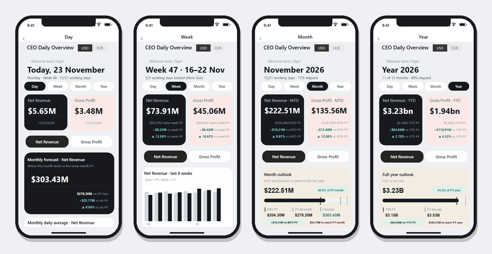

# CEO Daily Overview: a one-minute morning briefing in Power BI

*A mobile-first Power BI report that tells a CEO how the business is doing, in the time it takes to check a phone.*

**[▶ Open the interactive report](https://olga-bi-ba.github.io/Power-BI-portfolio/projects/ceo-daily-overview-mobile/)**

**Role:** BI Developer (end to end: requirements, prototype, data model, report) · **Tools:** Power BI Desktop, DAX, Deneb (Vega-Lite), HTML prototype, AI-assisted design

---

## Contents

1. [The solution](#the-solution)
2. [The problem](#the-problem)
3. [Goal and success criteria](#goal-and-success-criteria)
4. [Key features](#key-features)
5. [Process](#process)
6. [A non-trivial detail: comparing the right days](#a-non-trivial-detail-comparing-the-right-days)
7. [Built with Deneb for the phone](#built-with-deneb-for-the-phone)
8. [Data security approach](#data-security-approach)
9. [Result](#result)
10. [Lessons learned](#lessons-learned)
11. [Contact](#contact)

---

## The solution

Four pages, one per question the CEO asks: **Day, Week, Month, Year**. Each page has the same layout, so he always knows where to look.

## The problem

The CEO has very little time to check data but wants to stay on top of the business. He is rarely at a computer, yet his phone is always in his hand. The company's standard reports were built for desktop, so getting a quick answer meant opening a laptop, filtering and calculating in his head.

## Goal and success criteria

Give him one report that answers his questions at a glance, on a phone.
- He sees how each day, week and month is performing, with no math in his head.
- Every number is compared with the same period last year.
- He knows where the month will land and how fast it is moving.
- He sees how each department contributes.
- Everything is readable on a 320 px screen without zooming.

## Key features

- **Day, Week, Month, Year** pages with a consistent layout.
- **Comparison with last year** for every period, with the difference and percentage already calculated.
- **Monthly forecast** and daily average per working day.
- **"Speed" view:** a progress bar showing how fast the month is moving against the same period last year (my own addition to the brief).
- **Department breakdown** for the week, month and year.
- **One-tap switches** between Net Revenue and Gross Profit, and between USD and EUR.

## Process

1. **Interview:** I asked what matters to him: his tasks and the questions he needs answered.
2. **Jobs to be done:** I turned those into one job per page.
3. **HTML prototype:** we reviewed and agreed on it before any Power BI work.
4. **Build:** mobile layouts, DAX measures and custom visuals, iterated page by page.
5. **Review:** testing every switch and slicer on every page.

## A non-trivial detail: comparing the right days

Sales depend on the day of the week, and the same date moves by a weekday every year (23 November is a Monday in 2026, a Tuesday in 2027). Comparing with "the same date last year" would put a Monday next to a Sunday. I compare each day with the day exactly 52 weeks earlier, so weekdays always match, and the formula stays correct across leap years.

## Built with Deneb for the phone

Custom cards, grey-vs-black comparison bars and compact tables were built with Deneb (Vega-Lite), because standard visuals could not deliver the density and look needed on a small screen. Measures react to the Net Revenue / Gross Profit and currency switches on every page.

## Data security approach

Company policy did not allow sharing any sensitive data with AI, not even measure formulas. I studied what a PBIP project still stores about the data: slicer and filter selections, bookmarks, connection details, embedded data and more. I built an anonymization routine, designed the report on a safe copy, and reconnected it to the real model afterwards, so AI helped with the visual design without seeing company data.

## Result

The CEO now has a report designed for the way he actually works: open the phone, get the answer in about a minute.

## Lessons learned

Dense KPIs on a small screen take many small iterations on spacing and type. And AI can be used even under a strict data policy if you control exactly what leaves your machine.

## Contact

🔗 [LinkedIn](https://www.linkedin.com/in/olgasosinovich/)

[Back to contents](#contents)
