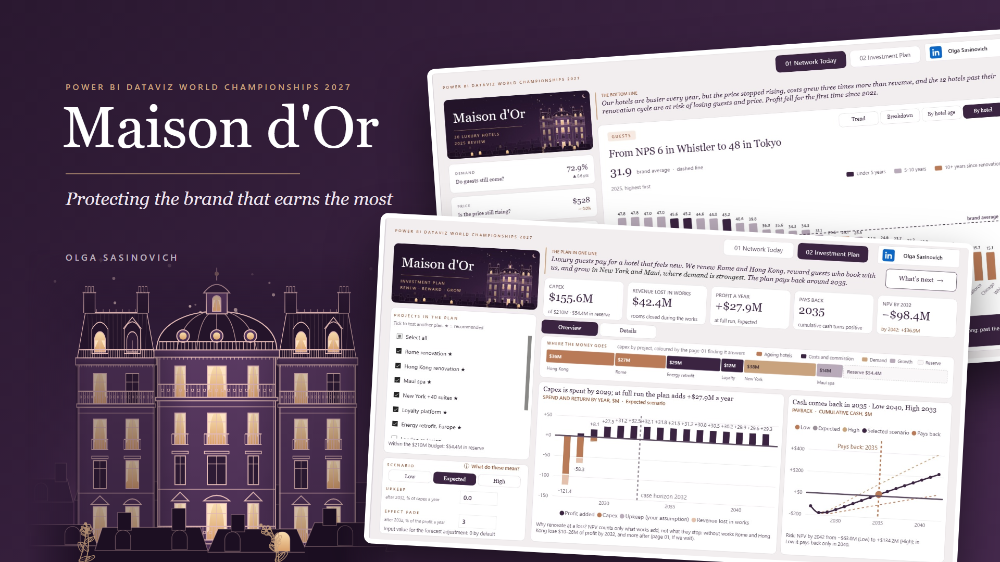

# Maison d'Or · Protecting the brand that earns the most

*Entry for the Power BI DataViz World Championships 2027, Round 1*

### ▶ [Open the interactive report](https://olga-bi-ba.github.io/Power-BI-portfolio/projects/maison-dor-investment-plan/)

## Audience
The group's leadership: CEO, CFO and the board who approve the capital budget.

## Problem
30 of the group's 165 hotels carry the Maison d'Or brand. They bring in a third of group revenue and 36% of its profit. Profit fell for the first time since 2021, and leadership does not see why or where to invest.

## Task
Explain what is happening to the brand and turn it into an investment decision: which projects to fund, how much, and when the money comes back.

## What the data says
- **Demand is strong.** Occupancy reaches 72.9%, and New York at 86% is close to full.
- **Profit is slipping.** The price stopped rising, costs grew three times faster than revenue, and profit fell for the first time since 2021.
- **Age is the cause.** Renovated hotels raise prices 4.6% a year and have twice the NPS. Hotels past the 12-year cycle grow 0.6% a year. 12 hotels are past it now; 27 of 30 will be by 2032.

## The plan
$155.6M in six projects, including 40 new suites in New York, plus $54.4M in reserve. It adds +$28M profit a year and pays back in 2035.

## The report
| Page | What you can do |
|---|---|
| 01 · Network today | Pick a question (demand, price, costs, profit, guests, hotel age, if we wait) and see the answer and what the plan does about it |
| 02 · Investment plan | Tick projects, switch scenario (Low / Expected / High) and see spend, return and payback |

## How to explore
The report is detailed on purpose, so readers can explore it on their own. A single chart can tell you profit fell; it cannot tell you whether it is costs or price, old hotels or new ones, the whole brand or three hotels. So every question on page 01 opens in four views, each answering a different "why":

- **Trend:** is it getting better or worse?
- **Breakdown:** what drives it?
- **By hotel age:** is it the age of the hotels?
- **By hotel:** which hotels, exactly?

The answer stays at the top; the views let you check it from every side, from the headline down to a single hotel.

## Built with
Power BI (PBIP), data modeling (galaxy schema: several fact tables sharing hotel, date and project dimensions), DAX measures with descriptions and folders, Deneb (Vega-Lite) visuals.

## Author
Olga Sasinovich · [LinkedIn](https://www.linkedin.com/in/olgasosinovich/)
