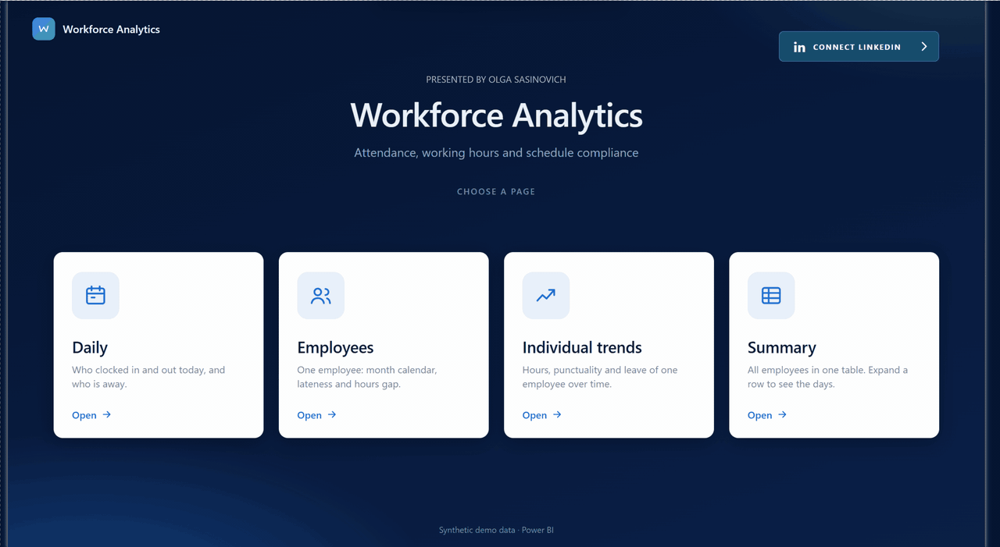
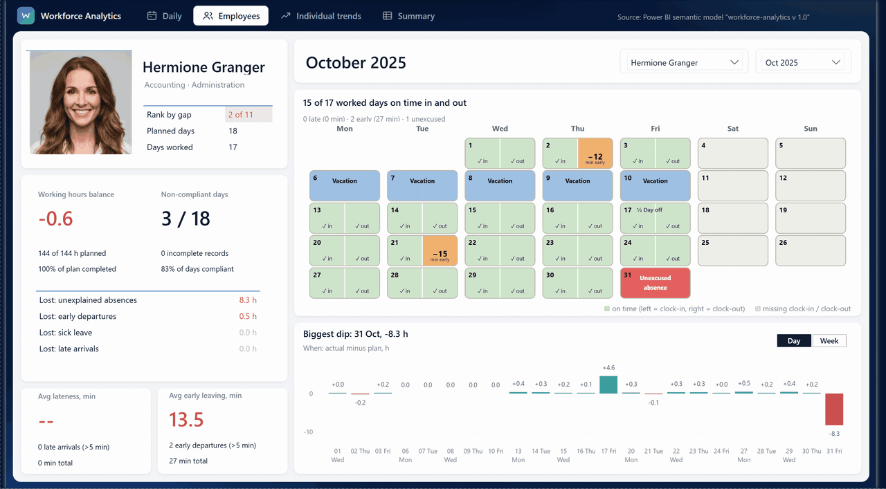
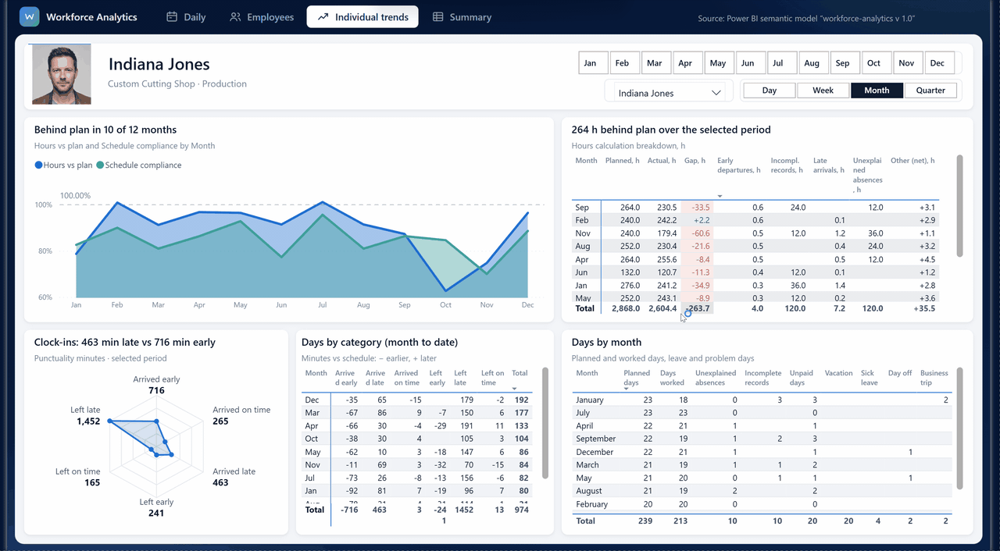
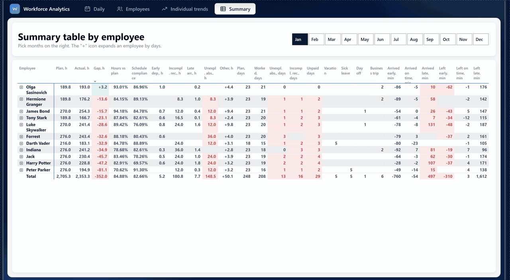

# Workforce Analytics — Attendance & Schedule Discipline Report 📊

An interactive Power BI report that shows whether a team is on plan: who clocked in and out on time, where the working hours went, and why the month is behind schedule.

> **Project Status:** Completed 🚀  
> **Tech Stack:** Power BI Desktop (PBIP / PBIR / TMDL), Power Query (M Language), DAX, Deneb (Vega-Lite), HTML/CSS mockups, Python, Claude Code with the Power BI Modeling MCP.

> **⚠️ Data note:** this is a **synthetic dataset**. Employees, departments, turnstile events and leave records are generated for the portfolio; employees carry names of film characters and their photos are AI-generated. The patterns (lateness, absences, seasonality, gaps to plan) are artificial and **may not resemble real-life workforce behaviour**. Read the numbers below as examples of how to read the report, not as benchmarks.

## 📑 Contents

- [🗂 Dataset in numbers](#dataset)
- [📷 Report pages](#pages)
  - [1. Daily](#daily)
  - [1b. Why is the hours balance off? (drill-down page)](#why)
  - [2. Employees](#employees)
  - [3. Individual Trends](#individual-trends)
  - [4. Summary](#summary)
- [🧩 Data model](#model)
- [🛠 Tools & technologies](#tools)

---

## 🗂 Dataset in numbers

| | |
|---|---|
| **Period** | 1 Jan – 31 Dec 2025 |
| **People** | 11 employees, 9 departments in 2 divisions (Production, Administration) |
| **Source data** | 4,883 turnstile events (clock-in / clock-out), 301 leave entries (vacation, sick leave, business trip, day off), 2 work schedules |
| **Plan vs actual (2025)** | 28,862 planned hours vs 26,792 worked hours (92.8% of plan, gap **-2,070 h**) |

**Rules the report is built on**
- **±5 minutes tolerance.** A clock-in more than 5 minutes after the scheduled start is *late*; a clock-out more than 5 minutes before the scheduled end is an *early departure*.
- **Month to date.** KPIs and titles count from the first day of the month up to the date picked on the page.
- **Hours bridge.** Planned hours → unexplained absences, sick leave, incomplete records (a missing clock-in or clock-out), late arrivals, early departures → actual hours. *Other (net)* is the remainder (for example extra hours).

---

## 📷 Report Screenshots

### 1. Daily
**What it shows.** The state of the team on one chosen day: every employee's clock-in and clock-out deviation from the schedule (in minutes, with the ±5 min rule), who is away today and why (unexcused, sick leave, day off, business trip, vacation), the working-hours balance of the month so far, and a cumulative gap-to-plan chart with a forecast for the month end. The chart can be switched between the trend and the departments. A button leads to the drill-down page *Why is the hours balance off?* (page 1b).

**Value.** The operational view for shift leads and HR. It answers in seconds: *Who came late or left early today? Who is absent and is it explained? Are we on track for the month's hours, and which department pulls the balance down?*

> Technical Features: Dynamic (DAX) insight titles, Conditional Formatting, Bookmarks & Buttons, Cross Filtering, Custom background with transparent visuals

**📌 Reading example (8 July 2025).** The working-hours balance is **`-39.3 h`**: 589 of 629 planned hours worked, **94%** of the plan so far. In the deviation table Indiana Jones is **`+26 min`** late and Forrest Gump **`+16 min`**; Olga Sasinovich left **`13 min`** early. Two people are on vacation and one is absent without a reason (James Bond).

[↑ Back to contents](#contents)

---

### 1b. Why is the hours balance off? (drill-down page)
**What it shows.** An explanation of the gap behind the Daily KPI: the hours bridge from planned to actual hours, the cumulative gap by department (waterfall), the gap by day or week, and a table of lost hours per employee with every cause in its own column.

**Value.** It turns *"we are behind plan"* into *"where, when, who and why"*, so the next action is clear (fix attendance records, talk to a department head, review absences). The page is hidden from the tab strip and opens only from the button on Daily.

> Technical Features: Waterfall Charts, Dynamic Titles, Visual Interactions, Conditional Formatting, Hidden page navigation

*The drill-down page is shown at the end of the Daily animation above (the button *Why is the hours balance off?*).*

**📌 Reading example (8 July 2025).** The **`-39.3 h`** gap is: plan 628.5 h, **`-24.0 h`** unexplained absences, **`-20.3 h`** incomplete records, `-2.7 h` late arrivals, `-1.1 h` early departures, `+8.7 h` other (net) = 589.2 h actual. **Panel Materials Warehouse** carries `-34.9 h` (89% of the total), the biggest dip is **3 July** (`-11.8 h`) and James Bond is furthest behind (`-23.9 h`).

[↑ Back to contents](#contents)

---

### 2. Employees
**What it shows.** One employee and one month: a profile card (photo, department and division, rank by gap, planned and worked days), the working-hours balance with plan completion and the number of non-compliant days, lost hours by cause, average lateness and average early leaving in minutes, an **attendance calendar** (each day is split into clock-in and clock-out halves; absences are coloured cells) and the hours gap by day or week.

**Value.** Preparation for a one-to-one or a performance review: *Is the gap caused by lateness, by early leaving, by unexcused absences or by missing records? Is it a pattern or a single bad week?* The calendar makes the pattern visible at a glance.

> Technical Features: Deneb (Vega-Lite) Calendar, Dynamic Images by URL, Field Parameters, DAX, Conditional Formatting, Dynamic Titles, Slicers

**📌 Reading example (Luke Skywalker, September 2025).** The balance is **`-34.3 h`** (170 of 204 planned hours, **83%**) and he ranks **11 of 11** by gap that month. Only **11 of 14** worked days were on time in and out: one late arrival (`15 min`), two early departures (`20 min` in total) and two unexcused absences (2 and 24 September, the red cells). The calendar also shows a sick day on the 1st and a week of vacation on the 8th–12th.

[↑ Back to contents](#contents)

---

### 3. Individual Trends
**What it shows.** The year of one employee: hours versus plan and schedule compliance by month (or day, week, quarter), a table that breaks every month's gap down into causes, a table of days (planned, worked, leave types, problem days), a **punctuality radar** (minutes early and late for clock-ins and clock-outs) and a matrix of minutes by category.

**Value.** It separates a bad month from a bad habit: *Is the employee consistently below plan? Do the losses come from absences or from records? Does the person tend to arrive early or late?*

> Technical Features: Deneb (Vega-Lite) Radar, Field Parameters, Button Slicers, Dynamic Titles, DAX, Conditional Formatting, Tables & Matrices

**📌 Reading example (Harry Potter, 2025).** Behind plan in **7 of 12 months**, **`-117 h`** over the year (2,727 of 2,844 planned hours). Most of the loss comes from incomplete records (`96 h`) and unexplained absences (`60 h`); lateness (`11 h`) and early departures (`5 h`) are small. The radar shows `767 min` of early clock-ins against `680 min` of late ones, so punctuality is not the problem; missing records are.

[↑ Back to contents](#contents)

---

### 4. Summary
**What it shows.** All employees in one matrix: rows are employees, and the **+** icon expands an employee into days. Columns bring together almost everything from the other pages (plan, actual, gap, hours versus plan, schedule compliance, lost hours by cause, days by type, minutes of early and late clock-ins and clock-outs). Month buttons on top choose the time frame. Late arrival minutes, early departures, unexplained absences, incomplete records and unpaid days turn red when above zero; the gap is red or green.

**Value.** One table for HR and payroll review: compare people side by side for any period, then open a person and find the exact days behind the number. It replaces opening the individual pages one by one.

> Technical Features: Matrix with expandable hierarchy, Conditional Formatting by measure (also on subtotals and totals), Button Slicer, Visual-level filters, DAX

**📌 Reading example (all of 2025).** All 11 employees finish below plan, from **`-117 h`** (Harry Potter) to **`-270 h`** (Peter Parker), `-2,070 h` in total. The two warehouse departments alone account for about 38% of it (Panel Materials Warehouse `-396 h`, Warehouse `-387 h`). By cause, incomplete records (`1,172 h`) and unexplained absences (`947 h`) dwarf late arrivals (`84 h`) and early departures (`61 h`); extra hours (`+510 h`) offset a part of the loss. In this synthetic data the issue is attendance records and absences, not punctuality.

[↑ Back to contents](#contents)

---

## 🧩 Data Model

A star schema built in Power BI (TMDL).

| Layer | Tables |
|---|---|
| **Facts** | `Fact_InOut` (4,883 turnstile events with the delay in minutes against the schedule), `Fact_Leave` (301 leave entries, full and half days), `Fact_PlanDay` (2,871 planned employee-days, calculated from schedules, holidays and leave) |
| **Dimensions** | `dim Employee` (11 people, photo URL), `dim Department` (9 departments with division), `dim Calendar` (explicit date table), `dim Schedule`, `dim Holiday`, `dim LeaveType`, `dim Month` |
| **Helper tables** | Field parameters (`Calendar Field`, `OV Granularity`), axis and category tables for the hours bridge, the punctuality radar, *Who is away* and *Lost hours*, and the profile lines of the Employees page |
| **Measures** | About 160 DAX measures in one `_Measures` table, grouped in display folders (overview, individual, to-date logic, design and insight titles) |

**Relationships.** `Fact_InOut`, `Fact_Leave` and `Fact_PlanDay` join `dim Employee` and `dim Calendar` (one-to-many, single direction); `Fact_Leave` also joins `dim LeaveType`; `dim Employee` joins `dim Department`.

**Modelling decisions**
- **Five-minute rule** in a calculated column (`Vtype`): each event is *early*, *on time* or *late* for clock-in and clock-out. All lateness measures read from it, so the rule lives in one place.
- **`Selected date`** measure drives every month-to-date number; with nothing picked it falls back to the last date that has data.
- **Hours bridge** measures split the gap into causes; *Other (net)* is the residual so that the bridge always closes.
- **Insight titles are DAX measures** (the biggest driver, the department or the employee is calculated, not typed), with singular/plural handling and a "No data for the selection" fallback.
- **Clean model:** unused measures and tolerance parameter tables removed, auto date/time off, a dedicated date table, a report-level filter that excludes system glitch events.

[↑ Back to contents](#contents)

---

## 🛠 Tools & Technologies

| Area | Tools |
|---|---|
| **BI & modelling** | Power BI Desktop, PBIP project format (PBIR report + TMDL semantic model), Power Query (M) for CSV and Excel sources, DAX (measures, calculated tables and columns, field parameters) |
| **Custom visuals** | Deneb (Vega-Lite) for the attendance calendar and the punctuality radar |
| **Design** | HTML/CSS mockups first, page backgrounds rendered to PNG with headless Microsoft Edge, native Power BI visuals made transparent on top, one shared colour and font theme (Segoe UI) |
| **Data generation** | Python scripts for the synthetic employees, turnstile events and leave records; AI image generator for employee portraits; Pillow for cropping and resizing |
| **Quality checks** | JSON-schema validation of the PBIR files, DAX queries against the model to verify measures |
| **AI-assisted development** | Claude Code with the Power BI Modeling MCP (model edits and DAX checks) |
| **Delivery** | Git and GitHub for version control, Power BI Service for publishing |

**How to open.** Open the `.pbip` file in Power BI Desktop and refresh. The source files (CSV and Excel) are in the project folder.

[↑ Back to contents](#contents)
