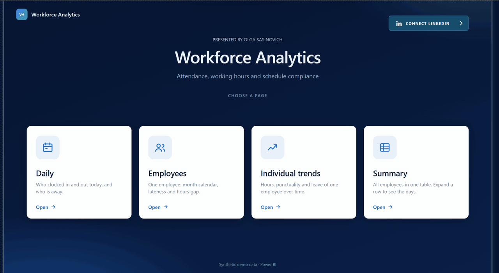
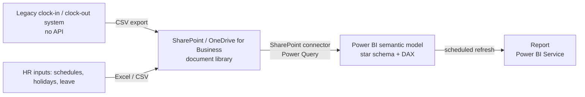
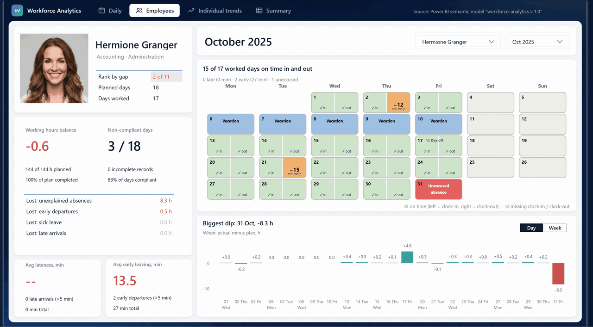
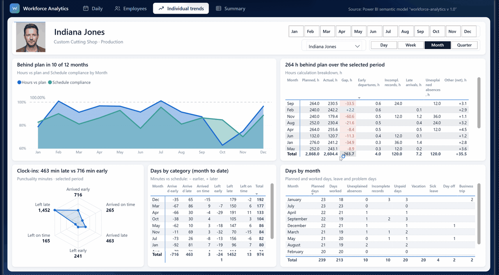
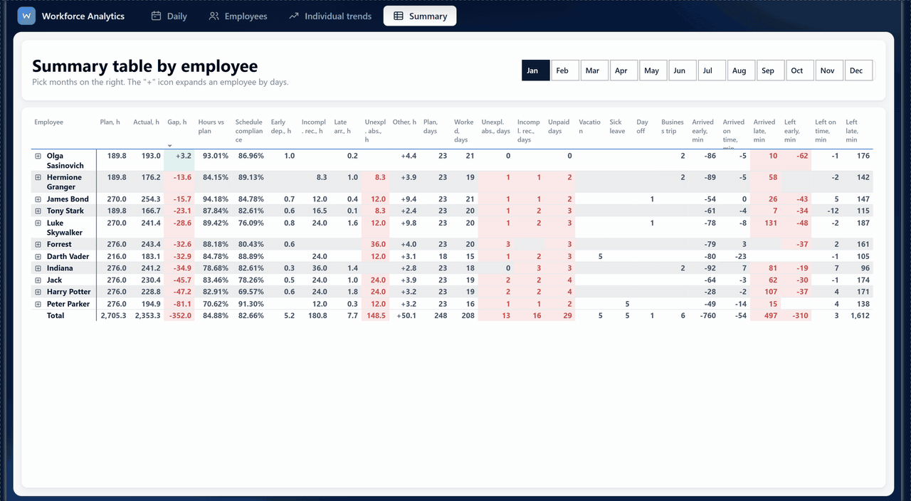

# Workforce Analytics: Attendance & Schedule Compliance 📊

An interactive Power BI report that turns raw clock-in / clock-out records from a legacy time-tracking system into an answer to one question: **is the team where the schedule says it should be, and if not, why?**

> **Tech Stack:** Power BI Desktop/Service, Power Query (M), DAX, Deneb (Vega-Lite), SharePoint, Claude Code with the Power BI Modeling MCP.

> **▶ Interactive report:** [open the live Power BI report](https://app.powerbi.com/view?r=eyJrIjoiNWU1YTFlMjgtOTYzZS00NDQ5LWE4NDgtZjkxMmI2YTkxODM4IiwidCI6ImZkYzVhNWIwLTYzM2QtNDQ2Ny05N2Q4LTE0ZjBlMzE4NDkwMCJ9) (or the [embedded page](report.html)). The data is synthetic, see the note below.

> **⚠️ Data note:** this is a **synthetic dataset**. Employees, departments, clock-in / clock-out events and leave records are generated for the portfolio; employees carry names of film characters and their photos are AI-generated. The patterns (lateness, absences, gaps to plan) are artificial and **may not resemble real-life workforce behaviour**. Read the numbers as examples of how to read the report, not as benchmarks.

## 📑 Contents

- [▶ Interactive report](#interactive)
- [🎯 The problem](#problem)
- [💡 The solution](#solution)
- [🔌 How the data gets into the report](#data-flow)
- [🗂 Dataset in numbers and business rules](#dataset)
- [📷 Walkthrough](#walkthrough)
  - [1. Daily](#daily)
  - [1b. Why is the hours balance off?](#why)
  - [2. Employees](#employees)
  - [3. Individual Trends](#individual-trends)
  - [4. Summary](#summary)
- [🧩 Data model](#model)
- [🛠 Tools & technologies](#tools)

---

## ▶ Interactive report

Try the report itself: [**Open Workforce Analytics in Power BI**](https://app.powerbi.com/view?r=eyJrIjoiNWU1YTFlMjgtOTYzZS00NDQ5LWE4NDgtZjkxMmI2YTkxODM4IiwidCI6ImZkYzVhNWIwLTYzM2QtNDQ2Ny05N2Q4LTE0ZjBlMzE4NDkwMCJ9). Pick a date, switch between trend and departments, and use the button on Daily to open the *Why is the hours balance off?* drill-down. The data is synthetic.

[↑ Back to contents](#contents)

---

## 🎯 The problem

In some businesses output depends directly on people being at their workplace at the agreed time: production lines, warehouses, shift-based operations. Every late arrival, early departure or unexplained absence is a lost working hour, and lost hours turn into missed output, overtime for colleagues and payroll disputes.

The company in this case had the raw material to see it, but not the means:

- **The clock-in / clock-out system is a legacy one.** It records every turnstile event, but data can only leave it as CSV files.
- **Plan and fact lived in different places.** Schedules, holidays and leave records were kept separately, so nobody could say how many hours *should* have been worked in a month, and how many were.
- **"We are behind plan" had no explanation.** Managers saw a total, but not whether the gap came from lateness, early leaving, sick leave, unexcused absences or simply a missing clock-in record.
- **Facts needed** Talking to an employee or a department head about attendance only works when both sides see the same neutral numbers for the same period.

The business task: **monitor schedule compliance every day, and be able to explain any deviation from plan down to the person and the day.**

[↑ Back to contents](#contents)

---

## 💡 The solution

A Power BI report that compares **planned hours** (built from schedules, holidays and leave) with **actual hours** (built from clock-in / clock-out events) and breaks the difference into causes.

- **One daily view for shift leads and HR:** who clocked in or out late or early today, who is away and whether that is explained, and whether the month is on track.
- **A drill-down from "what" to "why":** a *hours bridge* walks from planned to actual hours through unexplained absences, sick leave, incomplete records, late arrivals and early departures, then points to the department, the day and the person.
- **Preparation for one-to-one conversations:** an individual page with an attendance calendar, lost hours by cause, rank within the team and a year of trends.
- **±5 minute tolerance** decides what is late or early, defined once in the model, so every page and every number agrees.

[↑ Back to contents](#contents)

---

## 🔌 How the data gets into the report

Because the legacy system cannot be queried, the pipeline is built around **file exports**:

- The system's CSV exports are dropped into a **SharePoint (or OneDrive for Business) folder**. Power BI reads the folder with the SharePoint connector in Power Query, so new files are picked up on refresh and nobody has to touch the report.
- Because SharePoint Online is a cloud source, **scheduled refresh in the Power BI Service works without an on-premises gateway**.
- HR inputs (work schedules, holidays, leave) come from a simple Excel workbook that HR can edit themselves; the model turns them into a daily plan.
- Cleaning happens in Power Query: delimiters and encodings, types, system glitch events filtered out, and the delay in minutes calculated against the schedule.
- *In this portfolio copy the same files are generated synthetic data and are read from a local folder; only the source step of the queries differs.*

[↑ Back to contents](#contents)

---

## 🗂 Dataset in numbers and business rules

| | |
|---|---|
| **Period** | 1 Jan – 31 Dec 2025 |
| **People** | 11 employees, 9 departments in 2 divisions (Production, Administration) |
| **Source data** | 4,883 clock-in / clock-out events, 301 leave entries (vacation, sick leave, business trip, day off), 2 work schedules |
| **Plan vs actual (2025)** | 28,862 planned hours vs 26,792 worked hours (92.8% of plan, gap **-2,070 h**) |

**Rules the report is built on**
- **±5 minutes tolerance.** A clock-in more than 5 minutes after the scheduled start is *late*; a clock-out more than 5 minutes before the scheduled end is an *early departure*.
- **Month to date.** KPIs and titles count from the first day of the month up to the date picked on the page.
- **Hours bridge.** Planned hours → unexplained absences, sick leave, incomplete records (a missing clock-in or clock-out), late arrivals, early departures → actual hours. *Other (net)* is the remainder (for example extra hours), so the bridge always closes.

[↑ Back to contents](#contents)

---

## 📷 Walkthrough

### 1. Daily
**What it shows.** The state of the team on one chosen day: every employee's clock-in and clock-out deviation from the schedule (in minutes, with the ±5 min rule), who is away today and why (unexcused, sick leave, day off, business trip, vacation), the working-hours balance of the month so far, and a cumulative gap-to-plan chart with a forecast for the month end. The chart switches between the trend and the departments. A button leads to the drill-down page.

**Value.** The operational view for shift leads and HR: *Who came late or left early today? Who is absent and is it explained? Are we on track for the month's hours, and which department pulls the balance down?*

> Technical Features: Dynamic (DAX) insight titles, Conditional Formatting, Bookmarks & Buttons, Cross Filtering, Custom background with transparent visuals

**📌 Reading example (8 July 2025).** The working-hours balance is **`-39.3 h`**: 589 of 629 planned hours worked, **94%** of the plan so far. In the deviation table Indiana Jones is **`+26 min`** late and Forrest Gump **`+16 min`**; Olga Sasinovich left **`13 min`** early. Two people are on vacation and one is absent without a reason (James Bond).

[↑ Back to contents](#contents)

---

### 1b. Why is the hours balance off?
**What it shows.** An explanation of the gap behind the Daily KPI: the hours bridge from planned to actual hours, the cumulative gap by department (waterfall), the gap by day or week, and a table of lost hours per employee with every cause in its own column.

**Value.** It turns *"we are behind plan"* into *"where, when, who and why"*, so the next action is clear: fix attendance records, talk to a department head, review absences. The page is hidden from the tab strip and opens only from the button on Daily (shown at the end of the animation above).

> Technical Features: Waterfall Charts, Dynamic Titles, Visual Interactions, Conditional Formatting, Hidden page navigation

**📌 Reading example (8 July 2025).** The **`-39.3 h`** gap is: plan 628.5 h, **`-24.0 h`** unexplained absences, **`-20.3 h`** incomplete records, `-2.7 h` late arrivals, `-1.1 h` early departures, `+8.7 h` other (net) = 589.2 h actual. **Panel Materials Warehouse** carries `-34.9 h` (89% of the total), the biggest dip is **3 July** (`-11.8 h`) and James Bond is furthest behind (`-23.9 h`).

[↑ Back to contents](#contents)

---

### 2. Employees
**What it shows.** One employee and one month: a profile card (photo, department and division, rank by gap, planned and worked days), the working-hours balance with plan completion and the number of non-compliant days, lost hours by cause, average lateness and early leaving in minutes, an **attendance calendar** (each day is split into clock-in and clock-out halves; absences are coloured cells) and the hours gap by day or week.

**Value.** Preparation for a one-to-one or a performance review: *Is the gap caused by lateness, early leaving, unexcused absences or missing records? Is it a pattern or a single bad week?*

> Technical Features: Deneb (Vega-Lite) Calendar, Dynamic Images by URL, Field Parameters, DAX, Conditional Formatting, Dynamic Titles, Slicers

**📌 Reading example (Luke Skywalker, September 2025).** The balance is **`-34.3 h`** (170 of 204 planned hours, **83%**) and he ranks **11 of 11** by gap that month. Only **11 of 14** worked days were on time in and out: one late arrival (`15 min`), two early departures (`20 min` in total) and two unexcused absences (2 and 24 September, the red cells). The calendar also shows a sick day on the 1st and a week of vacation on the 8th–12th.

[↑ Back to contents](#contents)

---

### 3. Individual Trends
**What it shows.** The year of one employee: hours versus plan and schedule compliance by month (or day, week, quarter), a table that breaks every month's gap down into causes, a table of days, a **punctuality radar** (minutes early and late for clock-ins and clock-outs) and a matrix of minutes by category.

**Value.** It separates a bad month from a bad habit: *Is the employee consistently below plan? Do the losses come from absences or from records? Does the person tend to arrive early or late?*

> Technical Features: Deneb (Vega-Lite) Radar, Field Parameters, Button Slicers, Dynamic Titles, DAX, Conditional Formatting, Tables & Matrices

**📌 Reading example (Harry Potter, 2025).** Behind plan in **7 of 12 months**, **`-117 h`** over the year (2,727 of 2,844 planned hours). Most of the loss comes from incomplete records (`96 h`) and unexplained absences (`60 h`); lateness (`11 h`) and early departures (`5 h`) are small. The radar shows `767 min` of early clock-ins against `680 min` of late ones, so punctuality is not the problem; missing records are.

[↑ Back to contents](#contents)

---

### 4. Summary
**What it shows.** All employees in one matrix: rows are employees, and the **+** icon expands an employee into days. Columns bring together almost everything from the other pages (plan, actual, gap, hours versus plan, schedule compliance, lost hours by cause, days by type, minutes of early and late clock-ins and clock-outs). Month buttons choose the time frame. Problem columns turn red when above zero; the gap is red or green.

**Value.** One table for HR and payroll review: compare people side by side for any period, then open a person and find the exact days behind the number.

> Technical Features: Matrix with expandable hierarchy, Conditional Formatting by measure (also on subtotals and totals), Button Slicer, Visual-level filters, DAX

**📌 Reading example (all of 2025).** All 11 employees finish below plan, from **`-117 h`** (Harry Potter) to **`-270 h`** (Peter Parker), `-2,070 h` in total. The two warehouse departments alone account for about 38% of it (Panel Materials Warehouse `-396 h`, Warehouse `-387 h`). By cause, incomplete records (`1,172 h`) and unexplained absences (`947 h`) dwarf late arrivals (`84 h`) and early departures (`61 h`); extra hours (`+510 h`) offset a part of the loss. In this synthetic data the issue is attendance records and absences, not punctuality.

[↑ Back to contents](#contents)

---

## 🧩 Data Model

A star schema built in Power BI (TMDL).

| Layer | Tables |
|---|---|
| **Facts** | `Fact_InOut` (4,883 clock-in / clock-out events with the delay in minutes against the schedule), `Fact_Leave` (301 leave entries, full and half days), `Fact_PlanDay` (2,871 planned employee-days, calculated from schedules, holidays and leave) |
| **Dimensions** | `dim Employee` (11 people, photo URL), `dim Department` (9 departments with division), `dim Calendar` (explicit date table), `dim Schedule`, `dim Holiday`, `dim LeaveType`, `dim Month` |
| **Helper tables** | Field parameters (`Calendar Field`, `OV Granularity`), axis and category tables for the hours bridge, the punctuality radar, *Who is away* and *Lost hours*, and the profile lines of the Employees page |
| **Measures** | About 160 DAX measures in one `_Measures` table, grouped in display folders (overview, individual, to-date logic, design and insight titles) |

**Relationships.** `Fact_InOut`, `Fact_Leave` and `Fact_PlanDay` join `dim Employee` and `dim Calendar` (one-to-many, single direction); `Fact_Leave` also joins `dim LeaveType`; `dim Employee` joins `dim Department`.

**Modelling decisions**
- **Five-minute rule** in a calculated column (`Vtype`): each event is *early*, *on time* or *late* for clock-in and clock-out. All lateness measures read from it, so the rule lives in one place.
- **`Selected date`** measure drives every month-to-date number; with nothing picked it falls back to the last date that has data.
- **Hours bridge** measures split the gap into causes; *Other (net)* is the residual so that the bridge always closes.
- **Insight titles are DAX measures** (the biggest driver, department or employee is calculated, not typed), with singular/plural handling and a "No data for the selection" fallback.
- **Clean model:** unused measures and tolerance parameter tables removed, auto date/time off, a dedicated date table, a report-level filter that excludes system glitch events.

[↑ Back to contents](#contents)

---

## 🛠 Tools & Technologies

| Area | Tools |
|---|---|
| **BI & modelling** | Power BI Desktop, PBIP project format (PBIR report + TMDL semantic model), Power Query (M) for CSV and Excel sources, DAX (measures, calculated tables and columns, field parameters) |
| **Data source** | CSV exports from a legacy time-tracking system, SharePoint / OneDrive for Business folder, SharePoint connector in Power Query |
| **Custom visuals** | Deneb (Vega-Lite) for the attendance calendar and the punctuality radar |
| **Data generation** | Python scripts for the synthetic employees, clock-in / clock-out events and leave records; AI image generator for employee portraits; Pillow for cropping and resizing |
| **Quality checks** | JSON-schema validation of the PBIR files, DAX queries against the model to verify measures |
| **AI-assisted development** | Claude Code with the Power BI Modeling MCP (model edits and DAX checks) |
| **Delivery** | Git and GitHub for version control, Power BI Service for publishing |

[↑ Back to contents](#contents)
